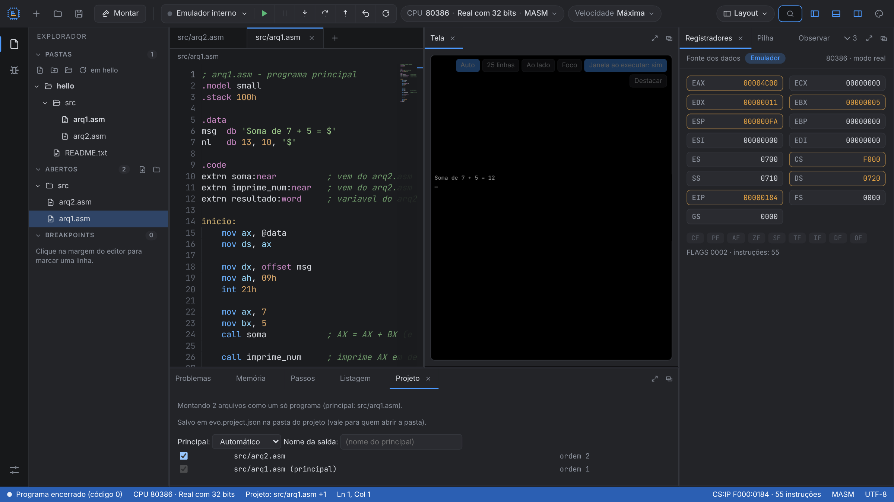
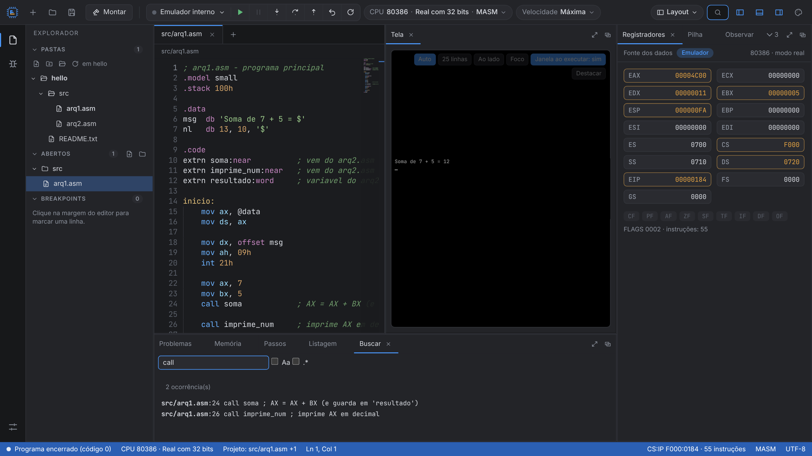
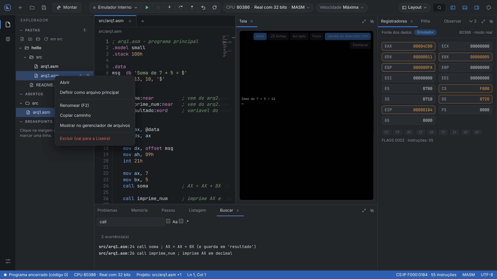
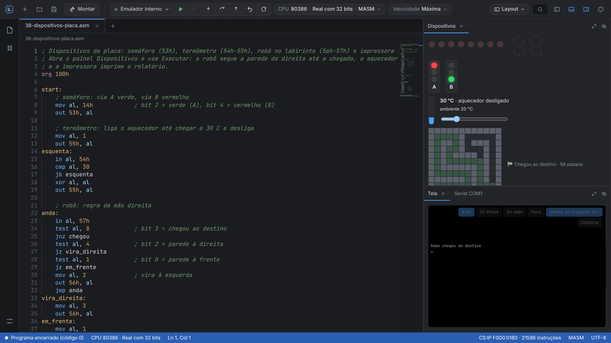

# EvoEmu386

IDE + emulador **x86 do 80386 ao Pentium** (modo real 16/32 bits e modo protegido) com editor, montador, depurador e tela de texto integrados. Compatível com programas no estilo emu8086 (8086/8088 e 80286 também disponíveis).

## Destaques
- **Editor** com realce de sintaxe, minimapa, pontos de interrupção e vários arquivos.
- **Montador** para MASM, TASM, FASM e NASM, com exemplos prontos (hello, SIB, strings, modo protegido, paginação, troca de tarefa, CPUID, x87…).
- **Depurador:** passo a passo, passo sobre, voltar um passo, registradores de 32 bits e flags, pilha, memória, observação de variáveis e desmontagem.
- **Tela de texto 80×25** que pode ficar embaixo, ao lado do editor, em modo foco (tela cheia) ou em **janela própria** ao executar.
- **Precisão:** núcleo validado contra os vetores do SingleStepTests (8086/8088, 80286 e 80386 em modo real).
- **Projetos de vários arquivos:** `INCLUDE` e módulos por `PUBLIC`/`EXTRN` viram um só programa, com erros apontando o arquivo e a linha; exporta **.EXE** e converte **EXE → COM/BIN**.
- **Explorador de pastas reais:** adicione pastas existentes, crie, renomeie, mova e exclua (Lixeira) direto no disco; configuração do projeto em `evo.project.json`.
- **Navegação no projeto:** a execução segue o arquivo onde parou, Listagem e Símbolos filtram por arquivo, busca em todos os arquivos (Ctrl+Shift+F), Salvar tudo e salvamento automático. Renomear ou mover um arquivo atualiza os `INCLUDE`.
- **Listagem `.LST`, mapa `.MAP` e objeto `.OBJ` (OMF):** exporte-os, ligue `.obj` de TASM/MASM/NASM e resolva `EXTRN` do seu `.asm` com bibliotecas `.obj`. `PROC FAR` e chamadas entre segmentos de código, e `ASSUME` verificado.
- **GROUP** (DGROUP/CGROUP) como no MASM/TASM, inclusive o modelo tiny que gera `.COM`.
- **Dispositivos virtuais:** semáforo, termômetro com aquecedor, robô num labirinto e impressora LPT1 (INT 17h), todos com painel visual; mais as portas do emu8086 (semáforo de 4 vias, motor de passo, display LED, E/S simples) ligadas por `#start=...#`.
- **Compatibilidade com os exemplos do emu8086:** 83 de 84 exemplos montam (diretivas em hexadecimal, tamanhos inferidos, macros e `emu8086.inc` com `PTHIS`, `CLEAR_SCREEN`, `PRINT_NUM_UNS`).
- **DOS virtual e `evoemu.inc`:** arquivos e memória pela INT 21h, biblioteca própria de procedimentos, visualizador de registradores em hex/decimal/binário.
- Executa no **QEMU** (com GDB), no **DOSBox-X** com seus compiladores DOS nativos e tem **terminal WSL** integrado.

## Download
Na página **[Releases](../../releases/latest)**, em *Assets*:

| Sistema | Arquivo |
|---|---|
| Windows (instalador) | `EvoEmu386-Setup-<versão>.exe` |
| Windows (portátil, sem instalar) | `EvoEmu386-<versão>-portable.exe` |
| Linux (x64) | `EvoEmu386-<versão>-linux-x86_64.AppImage` — `chmod +x` e execute; se não abrir, instale `libfuse2` |

No Windows, na primeira execução pode aparecer "O Windows protegeu seu computador" (o app ainda não é assinado digitalmente): clique em **Mais informações → Executar assim mesmo**.

Este repositório contém apenas os executáveis e as imagens de apresentação.
