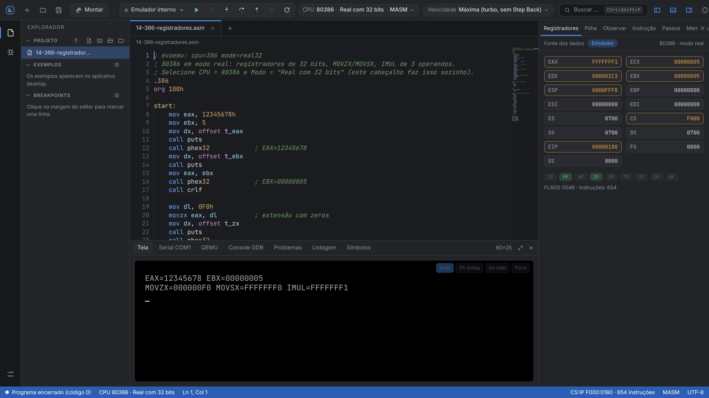
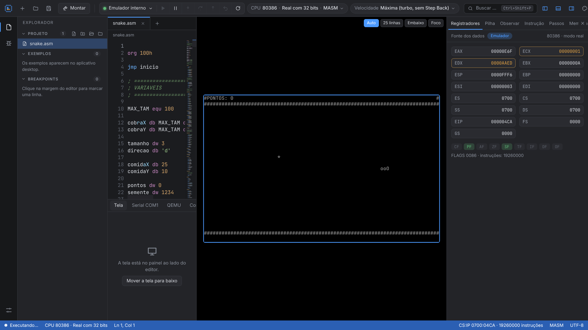
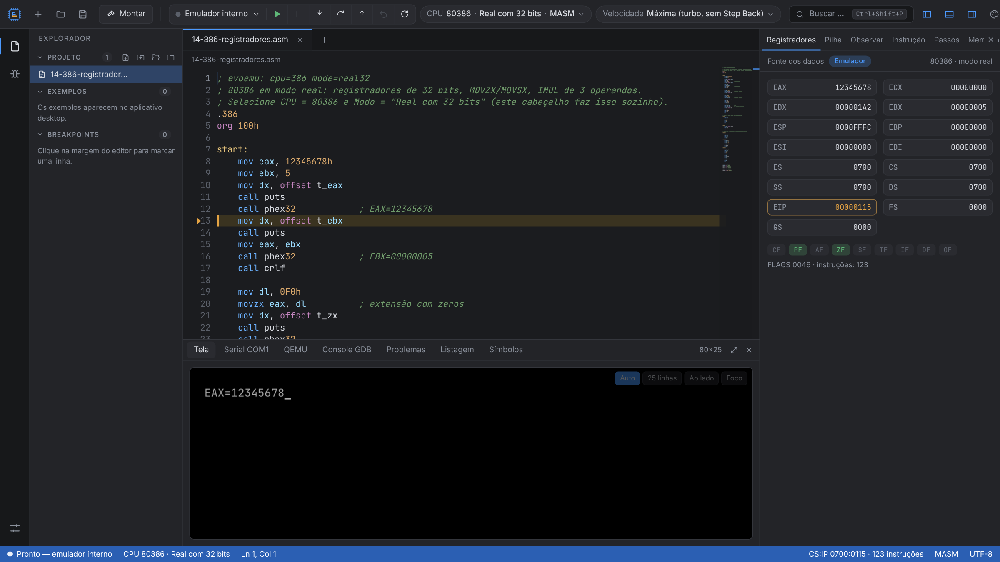

# EvoEmu386

IDE + emulador **x86 do 80386 ao Pentium** (modo real 16/32 bits e modo protegido) com editor, montador, depurador e tela de texto integrados. Compatível com programas no estilo emu8086 (8086/8088 e 80286 também disponíveis).

## Destaques
- **Editor** com realce de sintaxe, minimapa, pontos de interrupção e vários arquivos.
- **Montador** para MASM, TASM, FASM e NASM, com exemplos prontos (hello, SIB, strings, modo protegido, paginação, troca de tarefa, CPUID, x87…).
- **Depurador:** passo a passo, passo sobre, voltar um passo, registradores de 32 bits e flags, pilha, memória, observação de variáveis e desmontagem.
- **Tela de texto 80×25** que pode ficar embaixo, ao lado do editor, em modo foco (tela cheia) ou em **janela própria** ao executar.
- **Precisão:** núcleo validado contra os vetores do SingleStepTests (8086/8088, 80286 e 80386 em modo real).
- Opcionalmente executa no **QEMU** e depura via GDB.

## Download
Na página **[Releases](../../releases/latest)**, em *Assets*:

| Sistema | Arquivo |
|---|---|
| Windows (instalador) | `EvoEmu386-Setup-<versão>.exe` |
| Windows (portátil, sem instalar) | `EvoEmu386-<versão>-portable.exe` |
| Linux (x64) | `EvoEmu386-<versão>-linux-x86_64.AppImage` — `chmod +x` e execute; se não abrir, instale `libfuse2` |

No Windows, na primeira execução pode aparecer "O Windows protegeu seu computador" (o app ainda não é assinado digitalmente): clique em **Mais informações → Executar assim mesmo**.

Este repositório contém apenas os executáveis e as imagens de apresentação.
